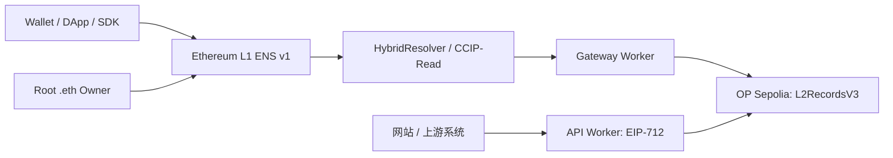
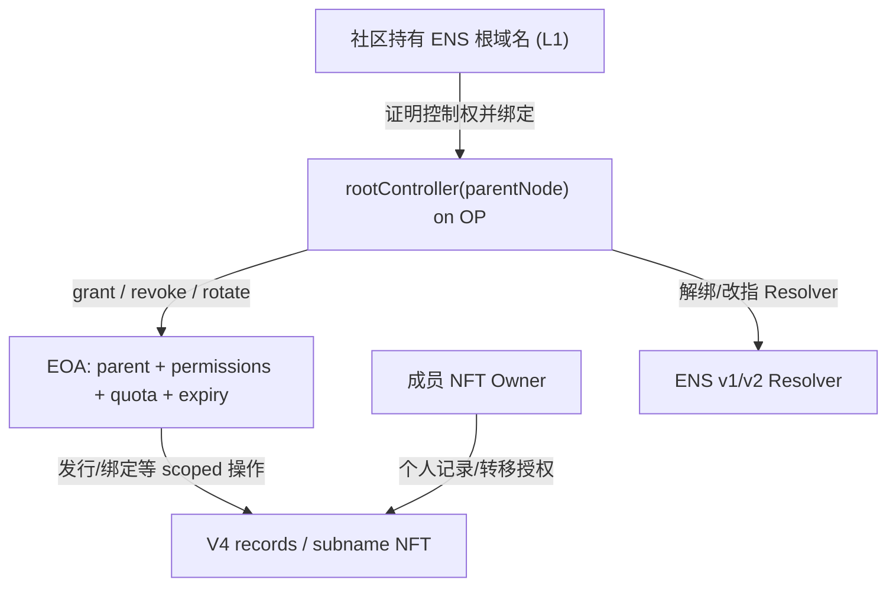

# CometENS Goal — 技术方案与已知安全边界

**审阅基线**：2026-10-20，仓库 `MushroomDAO/CometENS` 本地 `main` 记录 `3403518`，后续 G0 文档以该代码为初始取证点。ENSv2 事实截至 2026-10-20，随官方上游变化需再次核实；本文件区分“已实现”和“拟设计”，禁止把设计冒充已部署能力。

## 1. 已有系统（不重复开发）



| 能力 | 目前事实与依据 | G 任务 |
|---|---|---|
| L2 records / ERC-721 子域名 | `contracts/src/L2RecordsV3.sol`；README 只列 OP Sepolia 测试网地址 | G2 新合同，G5 测试网验证 |
| ENS v1 CCIP-Read | `contracts/src/HybridResolver.sol`，`workers/gateway/src/index.ts`；签名/证明模式双路径 | G3 解析策略与服务可靠性 |
| API 管理端点 | `workers/api/src/index.ts` 的 `/register`、`/set-addr`、`/set-text`、`/set-contenthash` 等；EIP-712 在 Worker 校验 | G1 SDK 写路径、G2 合约授权 |
| SDK 源码 | `sdk/CometENS.ts`、`sdk/types.ts`，但根 `package.json` 私有 `ens-tool@0.0.0`、无 package exports 或包构建；SDK 没有独立发布验证 | G1 SDK 解耦 |
| 管理员授权 | V3 的 `registrar + quota + expiry` 仅 owner 可设，且 owner 无条件绕过；`scripts/delegate.mjs` 仅适用 self-host Mode A | G2 Root Scoped Delegation |
| 自部署/托管 | `docs/SELF-HOSTING.md`、`docs/DELEGATED-HOSTING.md`；托管运营者可覆写/收回用户子域 | G2/G4 安全与 UX |
| 主网 | `README.md` 明确仅测试网；生产脚本和 Worker 参数不能作为可用生产部署证明 | G5/G6 |

**当前本地验证**：在 Node v22 的 PATH 下，`pnpm typecheck` 成功，`pnpm vitest run test/unit/` 为 38 文件/706 测试通过；`(cd contracts && forge test -q)` 成功。此结果不代表 Sepolia 在线端到端测试通过，不代表完成第三方审计。历史文档中的 198/101 数值为旧日期基线，后续应记录执行时间及新读数。

### SDK 缺口（经源码核对）

1. `sdk/CometENS.ts:getChains()` 用 RPC URL 是否包含 `sepolia` 猜链类型；自定义 RPC 域名不可靠。应显式配置 L1/L2 chainId，读取 RPC 核实并 fail-closed。
2. `CometENS.register()` / `setAddr()` 请求过时 `/api/manage/*`；生产 Worker 当前使用 `/register` 和 `/set-addr`，并要求 EIP-712 nonce/from/typed message 与域一致。现有 `register()` 在签名完成后构造 `Date.now()` nonce，不能保证签名合法；`setAddr()` 错用新地址作为 `from`。**在更正前不能发布写入 SDK。**
3. `resolve()` 返回空 `texts`，`setText()` 抛出未实现，配置类型缺少文档所称 `apiUrl`，`types.ts` 的“via CCIP-Read”说明与直接读 OP 的实现不符。
4. 没有以 SDK package 导入为入口的独立契约测试；现有 `pnpm typecheck` 窄范围配置也不足以证明新包可消费。

### 上线阻塞（P0）

- `L2RecordsV3.sol` 中全局 owner 的 `onlyOwnerOrRegistrar`、`_requireNodeAuth`、`transferSubnodeByGateway` 与 `setPrimaryNode` 允许跨社区发行/覆写/转移/反向改名；`docs/DELEGATED-HOSTING.md` 记录了对应测试和信任风险。G2 必须以链上权限消除委托者越权，无法靠 Worker 校验或 KMS 保证。
- `docs/DEPLOY-MAINNET.md` 的冷存 owner + 热 writer 推荐与 V3 的权限不匹配：registrar 只被允许发行，记录修改/代理转移仍要求 owner 或 NFT 持有人签为交易发送者。因此应先在新合约设计签名代理或按权限受限 operator 路径、配套 E2E 后再部署。
- `scripts/deploy-production.sh` 的目标合约版本与部分主网文档不一致；其变量替换机制可能同时修改 testnet 配置。G5 必须重写为环境作用域严格、可 dry-run、拒绝目标网络错配的部署流水线。
- Gateway `/hybrid` / 签名路径的 calldata/sender 与错误脱敏检查弱于 proof GET 分支，属于主网前必须修复并以黑盒测试证明的问题。密钥隔离仅减少失陷规模，不能解决 Gateway 签名权可任意伪造解析答案的问题。
- API Worker 中若 `ROOT_DOMAIN` 与 `ROOT_DOMAINS` 都缺失，部分 `/register` 根域名白名单路径会放行（`workers/api/src/index.ts`）；必须改为启动/请求 fail-closed，并覆盖错误部署测试。
- 现有 KV nonce `get` + `put` 缺乏原子性，且未配置 KV 时可能跳过重放保护。G1/G2 的写入接口需链上 nonce 或同等强度的原子状态门禁；不能以 KV 最终一致性作为不可重放承诺。

## 2. G1 SDK 稳定外观（拟定）

```typescript
type NetworkProfile = {
  l1ChainId: 11155111 | 1;
  l2ChainId: 11155420 | 10;
  l1RpcUrl: string;
  l2RpcUrl: string;
  l1Resolver: `0x${string}`;
  l2Records: `0x${string}`;
  apiUrl?: string;       // 显式设置，不通过 gateway URL 推导
  gatewayUrls: string[]; // 可空；直接 L2 read 不依赖网关
};

// 拟定的能力面；以下是设计示例，并非当前可运行 API。
interface CommunityENSClient {
  read: {
    getAddr(name: string): Promise<`0x${string}` | null>;
    getText(name: string, key: string): Promise<string | null>;
    resolve(name: string, strategy: 'l2' | 'ens'): Promise<unknown>;
  };
  owner: { grantOperator(input: unknown): Promise<unknown>; revokeOperator(input: unknown): Promise<unknown> };
  operator: { allocate(input: unknown): Promise<unknown>; setRecord(input: unknown): Promise<unknown> };
}
```

- `read`、`owner`、`operator`、`compat/ensv1`、未来 `compat/ensv2` 以子路径独立暴露，可树摇；默认公共读取无需钱包/密钥。
- 显式 `parentName` / `parentNode` 与当前持有者绑定，避免单 `ROOT_DOMAIN` 隐含操作范围。EIP-712 的 domain、chainId、verifyingContract、nonce、deadline 与签名时的消息必须逐字段一致。
- 错误结构至少包含 `kind`（invalid-input / unauthorized / revoked / stale / chain-mismatch / unsupported-network / rpc-unavailable / ccip-failure）、`chainId`、安全的关联 id；任何 RPC 凭据和私钥绝不进入错误响应。
- SDK 不强制调用本项目托管 worker；自部署者提供自己的 RPC/API/网关。第三方 AAStar 应通过组合适配器接入，避免形成对整个 `@aastar/sdk` 的循环依赖。
- ABI 和公开类型应提供语义版本；新版 V4 与 V3 协议适配器显式分离，不利用猜地址/读不出就降级到不安全接口。

## 3. G2 owner 与可撤销工作 EOA（拟定）



**控制平面**：社区自己的 L1 ENS 名字归社区 owner 持有。绑定特定 `parentNode` 到 OP 的 `rootController` 时，不能接受仅由平台后台填写的地址：必须有与 L1 所有权匹配的授权证明，明确 L1↔L2 验证信任方式（可验证消息/证明/经过审计的桥）。如果初版只能由可信方人工确认，产品必须如实声明其信任边界，并保留 owner 直接退出路径。ENS v2 与 v1 NameWrapper/授权差异分别处理。

**数据平面**：新合约把 `owner` 管理面与 operator 工作面分开；每个 parent 自成授权域，operator `CAP_ISSUE`、`CAP_BIND`、`CAP_SET_TEXT`、`CAP_SET_CONTENTHASH` 等逐位控制，默认最小权限。`quota` 和 `expiry` 仅由该 parent owner 配置；对已经发行的 NFT，operator 不能转移其产权，也不能单靠拥有发行权覆盖成员私有记录。成员级签名或授权以标准 EIP-712/EOA + EIP-1271（后续 G7）验证，不通过 gateway owner 超级权限执行。

**撤销语义**：owner 发 `revoke(parentNode, operator)` 链上交易，事件可索引。交易在 OP 被确认且应用读取到相应有效区块后，旧 operator 对该 parent 后续操作必须失败。已广播且先被打包的旧事务不倒退；RPC/缓存不能把旧批准视为有效的当前批准。过期、配额耗尽、域名转移、nonce 被消费均应独立阻断。L1 resolver 更换切断的是**解析路由**，不自动销毁 OP 上已发出的 NFT。

**共享服务两种形态**：

1. **独立部署（默认安全基准）**：每社区自己的 L2Records/owner（可多签）及 gateway signer；基础服务开源、无需 CometENS 秘钥和账户。
2. **共享运营**：同一 OP 合约托管多个 parent，必须以链上 `parentNode → rootController` 实现真正隔离；平台 worker 只持受限 EOA 和独立 gateway 签名者。若平台仍是共享合约可覆写任何用户 NFT 的全局 owner，就不能声称 owner 授权“随时可撤销地限制平台”。

**故障/恢复**：运营方停机时社区 owner 可以指向经自己控制的其他 resolver；不应指到 `0x0` 并声称已退出（ENS 可向祖先回退）。纯 offchain 的子名没有独立的 L1 节点/owner 时，也没有这一退出能力；对这类用户需公开约束并提供迁移/导出方案。

## 4. G3 ENSv1 / ENSv2 解析路径（拟定）

- **现状**：ENSv2 于 2026-08-12 开放 Sepolia beta；官方文档明确 v2 迁移两阶段，未迁移的 `.eth` 可经 `ENSV1Resolver` 延续解析；viem 官方兼容最低版本列为 `>=2.35.0`，当前依赖范围满足该版本基线，但仍需本地回归。
- **策略**：读链上 name 状态、resolver 和 registry 类型，决定解析 v1 / v2；只有官方确认该名称未迁移，才使用 v1 兼容路径。对于“已迁移但 v2 查询失败”，返回有语义的错误，拒绝静默退回旧 v1 记录产生 stale/劫持结果。
- **稳定性**：保留 V3 readonly 和现有签名+proof gateway 的兼容接口，增加 v2 adapter 和版本探针；针对 L1/L2 节点错误、网关不可用、过期证书、记录最终性、chain reorg 设置告警；缓存必须能失效且标注时间/来源/信任级别。
- **证明信任边界**：`HybridResolver` 当前模式由回应方选择，签名网关可以让客户端接受与 L2 真值不符的结果；不能将“proofMode: true”作为强制链上证明的承诺。应增加强制证明可选部署和直接读 OP 的一致性抽查，防止无痕伪造。
- **参考官方来源**（2026-10-20 核对）：[ENSv2 Overview](https://docs.ens.domains/ensv2/overview/)、[Migration](https://docs.ens.domains/ensv2/migration/)、[Readiness](https://docs.ens.domains/web/ensv2-readiness/)、[2026-08-12 Sepolia Beta](https://ens.domains/blog/post/ensv2-beta-public-testing)。监控程序在 G3 才实现，G0 尚无持续告警。

## 5. 部署/验收映射

| 阶段 | 链与组件 | 关键安全关口 |
|---|---|---|
| G1–G4 | 本地 Anvil 与 OP Sepolia / Ethereum Sepolia | SDK API、授权隔离、解析降级、防重放、解析结果与 L2 一致 |
| G5 | Sepolia 全链演练 | owner 多签、执行者权限、ENSv2 兼容、第三方安全审计、生产部署脚本 dry-run |
| G6 | OP Mainnet L2 records + Ethereum Mainnet L1 Resolver | 两条链的地址/版本/chainId/owner 与锁定 commit 相符；源码验证；SLO/应急撤销/回滚 |
| G7 | AAStar SDK + AirAccount | EOA/智能账户接口无权限提升，联合 CI 和实际用户旅程 |

“为所有 ETH 域名提供服务” = 所有合格 `.eth` 名称的**自主选择加入**，并不意味着平台可以替所有 owner 修改 ENS。对主网部署及公共解析服务的每一项权限都必须事先公开。
